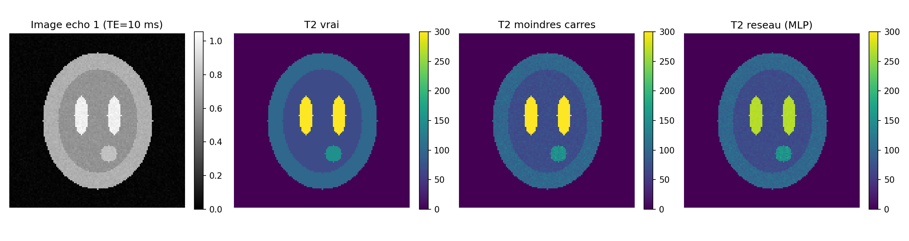

# Cartographie T2 en IRM : moindres carrés ou réseau de neurones ?

En IRM quantitative, on ne cherche pas seulement une belle image, on veut mesurer une grandeur physique dans chaque pixel. Ici c'est le temps de relaxation T2, qu'on estime à partir d'une acquisition multi-échos (8 échos).

J'ai comparé deux approches :

- la méthode classique : on passe le signal au logarithme, ce qui donne une droite, et on la résout par moindres carrés avec la pseudo-inverse ;
- un petit MLP en PyTorch (8 → 64 → 64 → 1), entraîné sur 50 000 signaux synthétiques.

Les deux sont testées sur un fantôme de cerveau simplifié (substance blanche, substance grise, LCR, une lésion), puis hors de la zone d'entraînement du réseau : bruit plus fort, T2 plus longs que ceux vus à l'entraînement.

## Ce que j'en retiens

Dans sa plage d'entraînement, le réseau est plus précis que les moindres carrés, surtout pour les T2 longs où la méthode classique se disperse. Dès qu'on sort de cette plage, c'est une autre histoire. Le LCR (T2 vers 1 000 ms) est estimé sous 300 ms par le réseau, parce qu'il n'a jamais vu de valeur plus grande, et rien ne signale l'erreur. Les moindres carrés, eux, retrouvent le bon ordre de grandeur parce qu'ils suivent directement l'équation physique.

C'est tout le problème du passage d'un modèle entraîné sur de la simulation à de vraies données de scanner.



## Lancer le notebook

```bash
pip install -r requirements.txt
jupyter notebook t2_mapping_pytorch.ipynb
```

Toutes les données sont simulées et les valeurs de T2 sont des ordres de grandeur simplifiés, pas des valeurs cliniques. Les figures sont enregistrées dans `figures/`.

Daoud Hechaïchi, élève-ingénieur ETI à CPE Lyon · [portfolio](https://daoud-hechaichi-cv.vercel.app)
